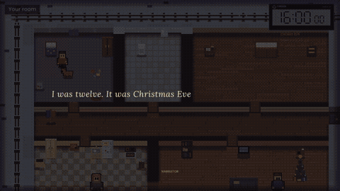
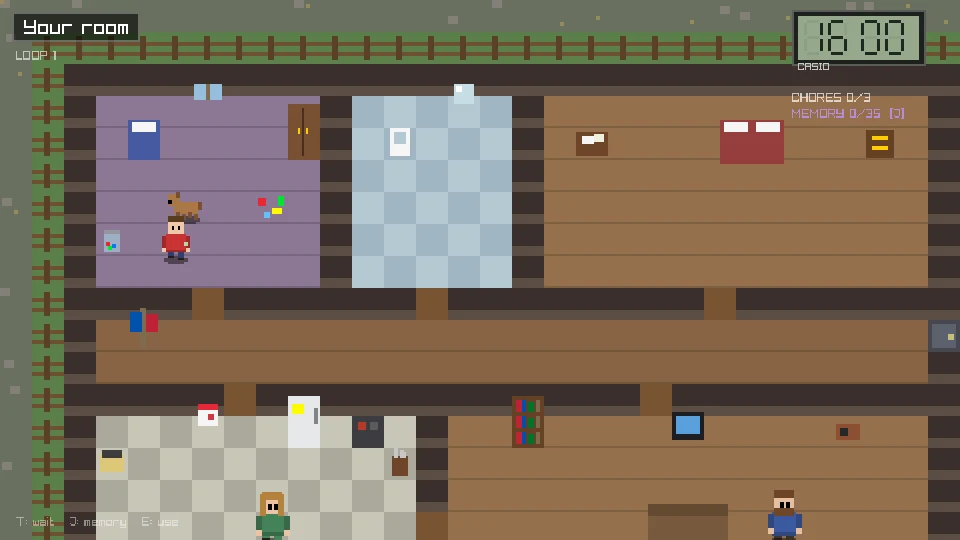
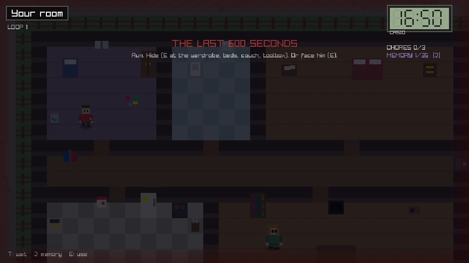
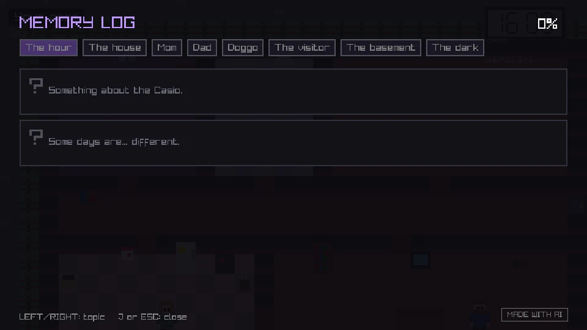

# 600 Seconds



A top down time loop game. You're a 12 year old kid in a lone house on Hardangervidda. At 16:50 a man comes to collect you. You remember every loop. Nobody else does.

This is a prototype and proof of concept from Sund Origin Studio. Placeholder art, synth sounds, one hour, one house. C++ and raylib, compiled to WebAssembly.

**Play it in the browser:** [sundorigin.org/600-seconds.html](https://sundorigin.org/600-seconds.html) or [itch.io](https://rillianz.itch.io/600-seconds-concept)

| | |
| --- | --- |
|  |  |
|  | |

Inspired by Twelve Minutes, Outer Wilds and The Forgotten City. Contains implied off screen violence.

## Controls

| Key | What it does |
| --- | --- |
| WASD / arrows | Walk |
| Shift | Run |
| F | Fullscreen |
| E / Space | Use things, talk, continue |
| Enter | Continue / pick a choice |
| Hold T | Wait (time runs 12x faster) |
| J | Memory log |
| Tab | Skip talking (from loop 2) |

Debug: add `?debug` to the URL, or press Shift+D on the title screen. `M` opens the jukebox (every song), `5` hops to the living room, `6` marks all five chores done, `7` opens the Fliptendo (Flappy Plane), `8` jumps 5 minutes, `9` jumps to 16:49, `0` jumps straight to the knock at the door. On the title screen, `Shift+R` twice is a true hard reset (memories, darkness, endings, achievements, save). `O` opens the debug panel (title or in game): reality shift frequency, force the next loop's reality, restart the loop, set dark points, give or clear all memories, make the visitor blind. Panel settings are saved in the browser and only apply in debug mode.

Phone: touch the screen and phone mode turns on. D-pad bottom left, E / RUN / WAIT bottom right, SKIP during talk, tap anywhere to use or continue, tap the top left for the memory log, tap a choice to pick it. The first tap goes fullscreen and asks for landscape.

In the Fliptendo mini game: E / Space / tap to flap, Esc to put it down. Memory log: left/right for topics (the last one is Endings), up/down or the mouse wheel to scroll.

Progress (memory log, loop count, achievements) is saved in the browser. `N` on the title screen starts over.

What changed in each version is in [CHANGELOG.md](CHANGELOG.md). Big spoilers in there.

## Code layout

```
src/game/World.h     map, rooms, objects (plain C++)
src/game/Story.h/.cpp all rules: clock, events, choices, memory log, saves (plain C++)
src/audio/Soundtrack.h/.cpp every song, written as code (plain C++)
src/main.cpp         raylib: drawing, input, sound, UI
test/sim.cpp         plays scripted loops headless and checks every memory is reachable
web/index.html       itch.io friendly page shell
```

`src/game` has no raylib in it. The story talks to the screen through a queue of "beats" (Say, Bubble, Narrate, Black, Fade, Choice, Clue, Sound, EndLoop). That's the part that moves to Unreal later. Only `main.cpp` gets rewritten.

## Adding stuff

- **New object**: add it to `objs` in `World.h`, give it a branch in `Story::Interact`, draw it in `DrawObj` in `main.cpp`.
- **New memory**: add a line to `AllMemories()` in `Story.cpp`, then call `AddClue("id")` where the kid learns it.
- **New knowledge choice**: in `Interact`, `if (Knows("id")) o.push_back({"choice_id", "text", true});` and handle `choice_id` in `Choose`.
- **New timed event**: add a `Crossed(prev, now, minute)` block in `CheckEvents`.

Run the logic test: `g++ -std=c++17 -Isrc test/sim.cpp src/game/Story.cpp -o sim && ./sim`

## Build it

Web (needs Emscripten and raylib built for web):

```
cd raylib/src && make PLATFORM=PLATFORM_WEB
RAYLIB_SRC=path/to/raylib/src ./build_all.sh   # build/web, build/site and the one-file build/single
```

Windows desktop (raylib installer / w64devkit):

```
g++ -std=c++17 -O2 -Isrc -IC:/raylib/raylib/src src/main.cpp src/game/Story.cpp src/audio/Soundtrack.cpp -LC:/raylib/raylib/src -lraylib -lopengl32 -lgdi32 -lwinmm -o 600Seconds.exe
```

Keep the `assets` folder next to the exe.

## itch.io

1. Zip the contents of `build/web` (index.html at the root of the zip).
2. New project, Kind: HTML, upload the zip, tick "This file will be played in the browser".
3. Viewport 960 x 540, tick "Fullscreen button".

## Credits

Code and writing: Noah Sund with Claude. Narrator font: Lora (SIL Open Font License, see `assets/narrator-font-OFL.txt`). UI font: Poppins (SIL Open Font License, see `assets/ui-font-OFL.txt`). Engine: raylib.
